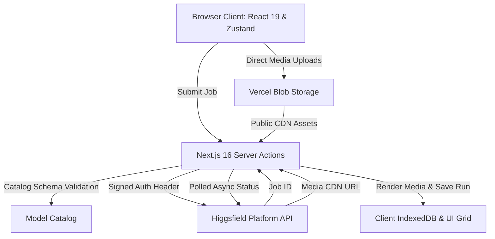

# Hansfield

<p align="center">
  <strong>Minimalist, high-performance web studio for multi-model AI image and video generation.</strong>
</p>

<p align="center">
  
  
  
  
  
  
</p>

---

## Overview

**Hansfield** is a free, open-source AI creative studio built for creators, designers, and developers. It brings together over **38 industry-leading image and video generation models** under a single, unified interface—powered by official platform APIs with zero vendor lock-in and zero subscription markups.

Engineered with an **"Atelier Light"** design aesthetic: zero emojis, minimal functional icons, distraction-free micro-copy, and a tactile floating composer dock.

---

## Key Features

### Unified Prompt Bar
- **Single Canvas for Image & Video**: Switch seamlessly between generation modalities without changing workspaces. The chosen model automatically configures the studio canvas.
- **Floating Composer Dock**: Ergonomic bottom pill dock housing model selection, settings chips, reference attachments, and submission controls.
- **Fast Execution**: Submit jobs instantly with `Ctrl + Enter` (`Cmd + Enter` on macOS).

### 38+ SOTA Models Supported
- **Image Models (8)**: Soul 2, Flux 1.1 Pro, Ideogram v2, Recraft v3, Seedance Image, Qwen Image, and more.
- **Video Models (30)**: Soul Cinema, Kling 3 (Turbo, Standard, Pro, 4K, Motion Control), Seedance 2.5 (Extend / Edit), Wan 2.1, LTX Video, MiniMax, PixVerse v3, Grok Imagine, and more.
- **Dynamic Parameter Schema**: Each model declares its allowed aspect ratios (16:9, 9:16, 1:1, 4:3), durations (5s, 10s), resolutions (720p, 1080p, 4K), and audio toggles dynamically from catalog definitions.

### Studio UX & Media Canvas
- **Pure Light Aesthetic**: Crisp porcelain backdrop (`#f6f7f9`), hairline borders, deep obsidian typography (`#111827`), and subtle elevation shadows.
- **Responsive Masonry Grid**: Live status tracking, virtualized rendering for large libraries, and automatic aspect-ratio-matched placeholders.
- **Comprehensive Asset Management**: Inspect runs in a fullscreen lightbox, reuse prompts and generation parameters with one click, favorite generations, and perform bulk batch downloads.
- **Privacy-First Local Persistence**: All generation history and metadata are stored locally in your browser via IndexedDB—no external database required.
- **Bring Your Own Key**: Secure platform authentication (`id:secret`) stored in httpOnly session cookies or optional environment variables.

---

## Supported Models

| Category | Model Highlights | Capabilities |
| :--- | :--- | :--- |
| **Image** | **Soul 2**, **Flux 1.1 Pro**, **Ideogram v2**, **Recraft v3** | Photorealistic portraits, typography rendering, vector artwork, multi-aspect ratios |
| **Video** | **Soul Cinema**, **Kling 3 (Pro / Turbo / 4K)**, **Wan 2.1** | Cinematic camera movements, motion dynamics, prompt-adherent video synthesis |
| **Extend & Edit** | **Seedance 2.5**, **Seedance 2.0 Fast** | Image-to-video, frame conditioning, temporal continuity extension |
| **Specialized** | **LTX Video**, **MiniMax Hailuo**, **PixVerse v3** | Fast turnaround, stylized renders, high framerate outputs |

---

## Architecture



- **Client**: Next.js 16 App Router, React 19, Zustand stores, `@tanstack/react-virtual`, Vanilla CSS.
- **Server**: Next.js Server Actions enforce that API keys and generation endpoints remain strictly server-side.
- **Storage**: Client IndexedDB for persistent gallery history; Vercel Blob for direct asset uploads.

---

## Getting Started

### Prerequisites
- Node.js 20.x or higher
- `pnpm` (recommended), `npm`, or `yarn`
- A platform API key (`id:secret`) from [Higgsfield AI](https://higgsfield.ai)

### Installation

1. **Clone the repository:**
   ```bash
   git clone https://github.com/hanovadevs/hansfield.git
   cd hansfield
   ```

2. **Install dependencies:**
   ```bash
   pnpm install
   # or: npm install
   ```

3. **Configure environment:**
   ```bash
   cp .env.example .env
   ```
   Add your credentials to `.env`:
   ```env
   HF_API_BASE_URL=https://api.higgsfield.ai
   HF_API_KEY=your_id:your_secret               # Platform key (or enter via UI)
   ```

4. **Launch the development server:**
   ```bash
   pnpm dev
   # or: npm run dev
   ```

5. Open [http://localhost:3000](http://localhost:3000) in your browser.

---

## Keyboard Shortcuts

| Shortcut | Action |
| :--- | :--- |
| `Ctrl + Enter` / `Cmd + Enter` | Submit generation prompt |
| `Esc` | Close modal / exit selection mode / close lightbox |
| `Shift + Click` | Multi-select media tiles in the gallery |
| `Delete` / `Backspace` | Remove selected runs from gallery |

---

## Scripts

| Command | Description |
| :--- | :--- |
| `pnpm dev` | Starts the Next.js development server on port 3000 |
| `pnpm build` | Compiles optimized production bundle |
| `pnpm start` | Runs the production build server |
| `pnpm brand` | Generates brand icons and OpenGraph assets |

---

## License

This project is open-source under the [MIT License](LICENSE).
